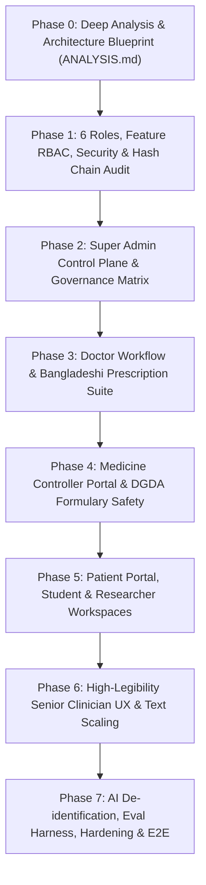

# ANALYSIS.md — DocMate AI Production-Ready SaaS Architecture & Gap Analysis

**System**: DocMate AI (ডকমেট এআই)  
**Target Audience**: Healthcare teams, clinicians, patients, students, researchers, and regulatory medicine controllers in Bangladesh  
**Author**: Principal Engineer, Product Designer & Clinical Safety Reviewer  
**Status**: Approved Architecture Blueprint (Phase 0)  
**Date**: November 2026

---

## 1. Executive Summary

DocMate AI is currently a working MVP demonstration featuring closed-library clinical decision support, deterministic drug safety checks, verbatim citation verification, and bilingual (Bangla default / English) support. 

This document defines the roadmap to transition DocMate AI from a synthetic hackathon prototype into a **hardened, production-grade SaaS** capable of securely managing **real patient health data (PHI)** in compliance with Bangladesh health and data protection guidelines, while maintaining a hyper-accessible, high-legibility interface tailored for busy, senior, non-technical clinicians operating on mobile phones and tablets.

### Fundamental Non-Negotiable Invariants
1. **Closed Library Only**: Zero external internet queries; zero LLM hallucinations. All clinical claims require verified chunk citations with normalized verbatim quote checks.
2. **Deterministic Medicine & Safety Rules**: Dosages, interaction warnings, renal adjustments, and contraindications originate solely from published, structured tables and deterministic TypeScript routines.
3. **Doctor in Control**: Clear disclaimers appear on all views. The AI provides suggestions; the physician retains final diagnostic and prescribing authority.
4. **Data Isolation & Scope**: Doctors see only their own patients; patients see only records explicitly shared by their doctor; students, researchers, and medicine controllers never see patient data; super admins have no clinical access except through audited, time-limited break-glass procedures.
5. **No Data Loss / Zero Blind Rewrites**: Existing data in PostgreSQL must be preserved. All database alterations proceed strictly via incremental migrations.
6. **No 100% Accuracy Claims**: The system never claims infallible accuracy in code, documentation, or user interfaces.

---

## 2. Current State Assessment (What Exists)

### Database & Persistence
- **Schema**: 9 core tables managed via Drizzle ORM on PostgreSQL with `pgvector`:
  - `users`: Basic accounts with 4 roles (`doctor`, `student`, `researcher`, `admin`).
  - `sources`: Literature and guideline metadata (WHO, NICE, etc.).
  - `chunks`: Ingested textual passages with `tsvector` full-text search index and 1536-dim embedding vector.
  - `cases`: Synthetic cases storing JSONB `structured_input`.
  - `case_turns`: Conversation stream for observations and follow-up turns.
  - `analyses`: LLM output logs, model identifiers, and token counts.
  - `drugs`: 30 pre-seeded generic drug rows with structured dose rules, contraindications, and renal thresholds.
  - `drug_interactions`: Directional interaction pairs with severity levels.
  - `audit_logs`: Standard event log table.

### Security, Auth & RBAC
- **Auth**: Cookie-based HMAC-SHA256 session tokens with 7-day expiration (`COOKIE_NAME = 'docmate_session'`).
- **Password Storage**: Scrypt with random 16-byte salt (`scrypt:salt:hash`).
- **Access Control**: Hardcoded role checks (`user.role === 'doctor' || user.role === 'admin'`). No granular feature-flagging or dynamic overrides.
- **Rate Limiting**: Ephemeral in-memory sliding window map.

### Clinical & AI Pipeline
- **Retrieval**: Concept-based PostgreSQL full-text search (`plainto_tsquery('english', ...)`) over indexed library chunks.
- **Verification**: `verifyClaims()` performs deterministic normalized-whitespace string matching against referenced `chunk_id`.
- **Abstention**: Triggers `insufficient_evidence` when vitals or chief complaint details are missing, generating clarifying follow-up questions.
- **Safety Engine**: Checks drug-drug interactions, patient allergies, and contraindications; recalculates regimen hashes and binds overrides to case versions.

### Frontend & Internationalization
- **Next.js 16 (Turbopack) & React 19**: App router with Base UI / Shadcn primitives.
- **i18n**: `next-intl` routing (`/[locale]/...`) supporting `bn` (Bangla default) and `en` (English) with strict 100% key parity verified by Vitest.
- **Responsive Layout**: AppShell sidebar on desktop; sheet drawers on mobile.

---

## 3. Gap Analysis Against SaaS Production Requirements

| Area | Current MVP State | Production SaaS Target | Gap & Action Required |
|---|---|---|---|
| **Roles** | 4 roles: `doctor`, `student`, `researcher`, `admin`. | 6 roles: `super_admin`, `doctor`, `student`, `researcher`, `patient`, `medicine_controller`. | Migrate existing `admin` to `super_admin`. Add `patient` and `medicine_controller` roles. |
| **Access Control** | Hardcoded `user.role` checks in code. | Dynamic feature-based RBAC (`canUse(user, feature)`) backed by `features`, `role_features`, and `user_feature_overrides`. | Build dynamic permissions engine, cache invalidation, super admin matrix UI, and server-side enforcement on all actions. |
| **Data Scope** | Basic check: doctor matches `case.doctorId`. | Strict isolation: doctors own patients; patients see only shared data; students/researchers/controllers blocked from PHI; super admin break-glass. | Implement centralized data-scope security layer and break-glass audited access. |
| **User Verification** | Instant demo accounts. | Mandatory professional verification: Doctor (BMDC + document), Student (institute email/ID), Researcher (ORCID/institute), Controller (invite only). | Build verification document uploads, review queue, and domain whitelisting. |
| **Authentication & MFA** | Password + cookie session. | Argon2id hashing, TOTP MFA (mandatory for super_admin & controller), session revocation, brute-force lockout. | Implement Argon2id with backward compatibility for scrypt, TOTP setup/verify, session store. |
| **Patient Data (PHI)** | Unencrypted JSONB in synthetic `cases`. | Relational tables: `patients`, `patient_accounts`, `encounters`, `vitals`, `allergies`, `prescriptions`, etc., with AES-256-GCM field encryption. | Implement relational clinical schema, field encryption/decryption, doctor-patient consent records, soft deletes. |
| **Bangladesh Fit** | Generic drug names and metric units. | Brand-first generic display (`Napa (Paracetamol) 500mg tablet`), Bangladeshi dose syntax (`1+0+1`), °F default, BMDC prescription printing. | Seed DGDA brand catalog, build `1+0+1` schedule parser, printable prescription view with QR code verification. |
| **Medicine Controller** | Static pre-seeded drug tables. | Dedicated portal for medicine controllers: DGDA status, brand mapping, two-person approval rule, safety notice publishing. | Build controller workflow, medicine versioning table, draft/review/publish lifecycle, safety notices. |
| **Patient Portal** | Non-existent. | Secure patient mobile portal: shared prescriptions, reminder schedule, report uploads, consent revocation, no AI diagnosis. | Build patient portal routes, OTP phone login, pre-visit intake questionnaires, document upload. |
| **Student / Researcher** | Simple library search & ask tab. | Student: Virtual patients, quizzes, study notes. Researcher: faceted search, side-by-side comparison, RIS/BibTeX export. | Implement virtual case generator, quiz attempts, research collections, citation exporter. |
| **Senior Clinician UX** | Standard dense web app. | Ultra-clear, large-text UI (18px default, scalable), 48px touch targets, 3-4 big actions per screen, Help sheets on every view. | Overhaul styling, implement font scale control (Normal/Large/XL), step indicators, accessible overlays. |
| **AI Governance** | Static prompt in code, unmetered. | Versioned prompt templates in DB, de-identification before external API calls, per-user usage metering, 30+ golden eval harness. | Build de-identifier, prompt versioning table, rate/cost meter, `eval/` automated test harness. |
| **Audit & Operations** | Simple event table. | Cryptographic append-only hash chain audit log (`sha256(prev_hash + payload)`), health checks, automated backup docs, Docker setup. | Implement hash-chained audit engine, health endpoints, production Dockerfile and Compose setup. |

---

## 4. Role Migration Plan (4 Roles → 6 Roles)

The database currently holds 4 distinct roles in the `users.role` column:
1. `doctor`
2. `student`
3. `researcher`
4. `admin`

### Migration Strategy
To avoid data loss or orphaned references, we execute an atomic SQL migration:
1. **Extend Valid Role Enum / Constraint**:
   Allow values: `'super_admin'`, `'doctor'`, `'student'`, `'researcher'`, `'patient'`, `'medicine_controller'`.
2. **Data Transformation**:
   - `UPDATE users SET role = 'super_admin' WHERE role = 'admin';`
   - Existing `doctor`, `student`, and `researcher` records remain unchanged.
   - For demo/seeded accounts, seed a dedicated `medicine_controller` (`controller@docmate.ai`) and a verified `patient` (`patient@docmate.ai`).
3. **Session Token Compatibility**:
   Update `sessionSchema` in `src/lib/session.ts` to accept all 6 roles. Existing active cookies for `admin` will be seamlessly promoted to `super_admin` or re-authenticated.

---

## 5. Security & Data Architecture Blueprint

### 5.1 Dynamic Feature-Based Access Control
Permissions are decoupled from roles into 3 tables:
- `features`: `key` (PK), `description`, `category`.
- `role_features`: `role`, `feature_key`, `enabled` (boolean), `daily_limit` (integer, null for unlimited).
- `user_feature_overrides`: `user_id`, `feature_key`, `enabled`, `daily_limit`, `expires_at`.

A centralized helper `canUse(user: User, featureKey: FeatureKey): Promise<{ allowed: boolean; reason?: string; limitRemaining?: number }>` evaluates:
1. Explicit active user overrides (checked first; expires if `expires_at < NOW()`).
2. Role-based default feature enablement.
3. Feature kill switches configured in `system_settings`.
4. Verification state (e.g. unverified doctors cannot execute `patients.manage`).

### 5.2 Field-Level Encryption for Patient Health Information (PHI)
To comply with medical privacy standards:
- **Encrypted Fields**: Patient `name`, `phone_number`, `national_id`, and `home_address`.
- **Algorithm**: AES-256-GCM using a 32-byte secret key (`PHI_ENCRYPTION_KEY`).
- **Format**: `enc:v1:<iv_hex>:<auth_tag_hex>:<ciphertext_hex>`.
- **Display Token**: A synthetic public `patient_code` (e.g. `P-847291`) is used for UI routing, search indexes, and logs. Plaintext PII is decrypted only in memory when rendered to authorized physicians or the patient themselves.

### 5.3 Cryptographic Audit Trail (Hash Chain)
The `audit_logs` table is upgraded to an append-only verifiable ledger:
- `id`: UUID.
- `prev_hash`: SHA-256 hash of the immediate prior log entry (genesis entry uses `'0'.repeat(64)'`).
- `event`: Event identifier (e.g. `patient.created`, `break_glass.invoked`, `access.modified`).
- `user_id`: Acting user.
- `payload`: Sanitized JSONB state (captures before & after values for changes).
- `hash`: `SHA-256(prev_hash + event + user_id + timestamp + JSON.stringify(payload))`.
Any tampering with historical audit records breaks the verifiable chain.

---

## 6. UX Philosophy for Senior Bangladeshi Clinicians

### Design Principles for Low-Tech, High-Stress Environments
1. **One Focus Per Screen**: Avoid cluttered dashboards. Each page possesses a single unambiguous goal.
2. **Bangla-First Natural Language**: Use culturally familiar medical phrasing (e.g. `নতুন রোগী`, `ওষুধের তালিকা`, `প্রমাণ দেখুন`) instead of software jargon.
3. **Step-by-Step Guidance (ধাপ ১/৪)**: Long clinical intakes are partitioned into digestible, linear stages with saved progress.
4. **Accessible Typography**:
   - Primary: `Noto Sans Bengali` with `Inter` fallback.
   - Base body text: **18px default** (never below 16px).
   - Line height: **1.7** for Bangla script legibility.
   - Font weights limited to 400, 500, and 600.
5. **Dynamic Interface Text Scaling**:
   A persistent `লেখার আকার` control offering **Normal (100%)**, **Large (115%)**, and **Extra Large (130%)** that scales the entire CSS root layout without horizontal clipping.
6. **Touch & Contrast Standards**:
   - Minimum button height: **48px**.
   - Body text contrast >= **7:1**; UI controls >= **4.5:1**.
   - No color-only status indicators; every alert pairs an icon with explicit wording.
7. **Always-Available Help ("সাহায্য")**:
   A persistent button in the header opens a 3-step actionable guide specific to the active view.

---

## 7. Phased Implementation Roadmap

### Phase 1: Core Foundation, 6 Roles, Feature RBAC & Audit Engine
- Database migration: Alter `users.role` enum, create `features`, `role_features`, `user_feature_overrides`, `doctor_verifications`, `student_verifications`, `researcher_verifications`.
- Central `canUse()` engine and data-scope security layer.
- Upgraded authentication: Argon2id hashing + legacy scrypt verification, TOTP MFA support.
- Cryptographic hash-chain audit logger.
- Write `docs/ACCESS.md` detailing the complete permission matrix.
- Automated access tests for all 6 roles against protected routes.

### Phase 2: Super Admin Control Plane
- User Management: verification approvals/rejections, role reassignment, session termination.
- Access Control Matrix UI: interactive toggle matrix (roles × features), daily limits, user overrides with expiration date, "View as Role" simulation.
- Medical Library Management: draft → in review → approved → published lifecycle.
- AI Configuration: model selection, chunk limits, abstain threshold, prompt version manager, global kill switches.
- Plans & Billing: tier configuration, manual activation, payment stubs (bKash, Nagad, SSLCommerz).
- System & Audit Log viewer with hash-chain integrity verification.

### Phase 3: Doctor Workflow & Bangladeshi Clinical Prescribing
- Relational patient clinical models: `patients`, `encounters`, `vitals`, `allergies`, `chronic_conditions`, `current_medicines`, `lab_results`, `attachments`.
- Field-level encryption for patient identity (AES-256-GCM).
- 4-Step Patient Intake workflow (`ধাপ ১/৪`) with consent checkbox and tap-chip symptom selectors.
- Bangladeshi prescription engine: `1+0+1` dosage notation, before/after meals, duration, follow-up dates.
- High-resolution printable & PDF prescription layout formatted for BMDC standards with doctor header and QR validation.

### Phase 4: Medicine Controller & DGDA Formulary Engine
- Expanded formulary tables: generic catalog, `medicine_brands`, `medicine_versions`, `medicine_notices`.
- Medicine Controller Portal: pending queues, generic/brand management, DGDA approval status, CSV importer with schema validator.
- Two-Person Review rule toggle: requires secondary controller or super admin sign-off before publishing.
- Safety notices broadcast system (withdrawn drugs, recalls, batch warnings).
- Safety engine adaptation to query only verified, published drug records.

### Phase 5: Patient Portal, Student & Researcher Workspaces
- **Patient Portal**: Mobile-first views for prescriptions, daily dosage reminder schedule, patient-friendly drug instructions, report uploads, pre-visit questionnaire, and consent revocation.
- **Student Workspace**: Library Q&A, interactive virtual patient clinical practice cases, flashcards, chapter quizzes, and personal notes.
- **Researcher Workspace**: Advanced search with facet filters (evidence level, year, source), side-by-side guideline comparison, collection saving, and citation export (CSV, RIS, BibTeX).

### Phase 6: UX Overhaul for Older & Low-Tech Clinicians
- Implementation of `TextSizeControl` (`লেখার আকার`: Normal, Large, Extra Large) with root CSS variable scaling.
- Typography pass: enforce 18px body minimum, line height 1.7 for Bangla, 48px touch targets, >= 7:1 contrast.
- Universal `সাহায্য` (Help Sheet) with 3 step-by-step points on all primary screens.
- Interactive skippable first-time tour (<= 5 steps).
- Mobile bottom navigation bar (4 primary actions + sheet).
- Write `docs/UX_CHECKLIST.md` with 2-minute unassisted completion tests for each persona.

### Phase 7: AI Privacy, Eval Harness, Hardening & Deployment
- Automated de-identification pipeline: strips patient identifiers before LLM ingestion.
- Database-driven prompt versioning with rollback.
- Golden test evaluation harness: `eval/` suite with 30+ benchmark cases testing citation accuracy, abstention compliance, and drug safety checks (`pnpm run eval`).
- Production Dockerfile, hardened `docker-compose.yml`, CSP headers, backup/restore documentation.
- Write `docs/COMPLIANCE.md` analyzing Bangladesh health data protection and DGHS/BMDC regulatory checkpoints.
- Full Playwright E2E suite covering all 6 roles and responsive viewports (390px, 768px, 1280px).

---

## 8. Risk Management & Mitigations

| Risk | Impact | Mitigation Strategy |
|---|---|---|
| **PHI Leakage in AI Queries** | Critical | Client-side and server-side de-identifier scrubs name, phone, NID, address. Only age, gender, and clinical facts pass to LLM. |
| **Accidental Clinical Misuse** | Critical | Persistent disclaimer on every screen. Automated prescribing remains clinician-confirmed only; non-bypassable hard stops on severe allergies and pregnancy Category X. |
| **Slow Rural Internet** | High | Aggressive `sessionStorage` draft autosaving, lightweight bundles, optimistic UI, offline retry notices. |
| **Database Migration Data Loss** | High | Strictly incremental migrations using Drizzle Kit; pre-migration backups automated in scripts; no column dropping. |
| **Cognitive Overload for Senior Doctors** | High | Max 3-4 primary buttons on homepage; progressive disclosure; big touch targets (>= 48px); native Bengali terminology. |
| **Audit Trail Tampering** | High | SHA-256 hash chaining on all log records. Any alteration to prior entries invalidates downstream chain signatures. |

---

## 9. Next Steps
With Phase 0 complete, implementation proceeds sequentially to **Phase 1: 6 Roles, Feature RBAC, Security & Hash Chain Audit Engine**.
