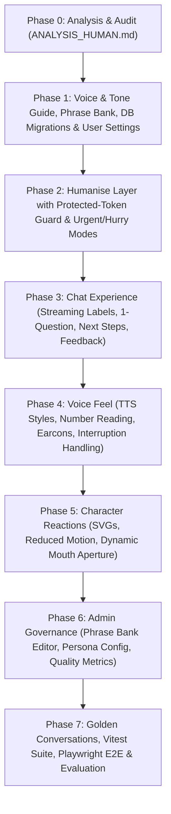

# ANALYSIS_HUMAN.md — DocMate AI Humanization & Tone Architecture Audit

## Executive Summary
This document provides a comprehensive audit of all text, speech, and state transitions in DocMate AI. While the clinical verification engine, DGDA formulary, closed library retrieval, and voice pipeline function deterministically, the current linguistic layer and voice interface exhibit robotic repetition, overly formal/bureaucratic Bangla phrasing ("সাধু/অনুবাদ" style), rigid timing, and an absence of doctor-centric conversational warmth.

This analysis maps every assistant touchpoint, documents hard-coded and stiff strings, diagnoses robotic interaction patterns, and details an 8-phase execution roadmap to transform DocMate AI into a natural, respectful, and clinically safe medical partner.

---

## 1. Inventory of Current Text & Sound Generation

### 1.1 Chat API & Reasoning Synthesis (`src/app/api/cases/[id]/turns/route.ts`)
| File & Lines | Current String / Pattern | Issue & Tone Defect | Target Conversational Pattern |
| :--- | :--- | :--- | :--- |
| **`route.ts:288-291`** (Clinical Question Answer) | `ডাক্তার, আপনার ক্লিনিকাল জিজ্ঞাসার প্রেক্ষিতে আমাদের অভ্যন্তরীণ মেডিকেল লাইব্রেরি থেকে সংশ্লিষ্ট প্রমাণ পর্যালোচনা করা হয়েছে:\n\n• **লাইব্রেরি প্রমাণ**: ...` | Stiff, bureaucratic, repetitive ("ক্লিনিকাল জিজ্ঞাসার প্রেক্ষিতে"). Ignores doctor's preferred address style. | Warm acknowledgement + direct 1-2 sentence core answer + citation chip + single next step. |
| **`route.ts:293-296`** (Evidence Review Request) | `ডাক্তার, অভ্যন্তরীণ মেডিকেল লাইব্রেরি থেকে রোগীর বর্তমান লক্ষণ ও ডেটার সমন্বিত প্রমাণ পর্যালোচনা সম্পন্ন হয়েছে। চূড়ান্ত ডিফারেনশিয়াল রোগ নির্ণয়ের আগে শারীরিক পরীক্ষার কিছু গুরুত্বপূর্ণ তথ্য বা ল্যাব রেজাল্ট নিশ্চিত করা আবশ্যক (Insufficient Evidence)।` | Cold, machine-like ("সমন্বিত প্রমাণ পর্যালোচনা সম্পন্ন হয়েছে"). Uses developer terminology ("Insufficient Evidence"). | `লাইব্রেরির প্রমাণ পর্যালোচনা করেছি। নিশ্চিত রোগ নির্ণয়ের জন্য আরও কিছু তথ্য প্রয়োজন:` + targeted single question. |
| **`route.ts:303-305`** (Fact Extraction) | `ডাক্তার, আপনার পর্যবেক্ষণ থেকে **${proposedUpdates.length}টি ক্লিনিকাল তথ্য** (${factNames}) সফলভাবে নিষ্কাশন করা হয়েছে। রোগীর নথিতে এই তথ্যগুলো অন্তর্ভুক্ত করার জন্য অনুগ্রহ করে নিচের প্রস্তাবিত কার্ডগুলো নিশ্চিত করুন।` | Robotic system log style ("সফলভাবে নিষ্কাশন করা হয়েছে"). Unnatural phrasing. | `পর্যবেক্ষণ থেকে ${count}টি তথ্য পেয়েছি (${factNames})। রোগীর ফাইলে যোগ করতে চান?` |
| **`route.ts:308-310`** (Default Observation) | `ডাক্তার, আপনার ক্লিনিকাল পর্যবেক্ষণ কেস হিস্ট্রিতে লিপিবদ্ধ করা হয়েছে। রোগীর নির্ভরযোগ্য মূল্যায়ন নিশ্চিত করতে পরবর্তী প্রাসঙ্গিক প্রশ্নসমূহ নিচে দেওয়া হলো।` | Rigid boilerplate repeated on every doctor observation. | `লিখে নিয়েছি।` / `নোট সংরক্ষণ করা হয়েছে।` (Phrased naturally from phrase bank variants). |
| **`route.ts:314-331`** (Follow-up Questions) | Multiple numbered questions dumped together: `1. ভাইটালস...\n2. স্টেথোস্কোপে ফুসফুসের শব্দ...` | Violates conversational rule: asks 2-3 questions at once. Overwhelms busy doctors. | **One question per turn**. Offer max 3 quick-reply options as interactive chips. |
| **`route.ts:269-277`** (Red Flag Safety Alert) | `🚨 জরুরি রেড ফ্ল্যাগ: তাৎক্ষণিক ক্লিনিকাল হস্তক্ষেপ প্রয়োজন` | Clear clinical warning, but lacks standard persona intro (`alert_intro`). | Immediate calm, firm intro (`একটি জরুরি সতর্কতা:`) followed by unadulterated clinical fact. |

---

### 1.2 Spoken Formatter & Voice Synthesis (`src/lib/voice/speakable.ts` & `dose-speech.ts`)
| File & Lines | Current String / Pattern | Issue & Robotic Defect | Target Voice Pattern |
| :--- | :--- | :--- | :--- |
| **`speakable.ts:50`** (No Data Found) | `কোনো তথ্য পাওয়া যায়নি। বিস্তারিত স্ক্রিনে দেখুন।` | Abrupt, blunt, robotic. | `এ বিষয়ে লাইব্রেরিতে তথ্য মেলেনি। বিস্তারিত স্ক্রিনে দেখতে পারেন।` |
| **`speakable.ts:57`** (Unverified Claim) | `পর্যাপ্ত প্রমাণ নেই। অপ্রমাণিত তথ্য মুখে বলা হয় না।` | Moralizing / defensive tone ("অপ্রমাণিত তথ্য মুখে বলা হয় না"). | `এটির পক্ষে পর্যাপ্ত লাইব্রেরি প্রমাণ পাওয়া যায়নি।` |
| **`speakable.ts:65, 70`** (Insufficient Evidence) | `প্রমাণ অপর্যাপ্ত। নির্ণয়ের জন্য অতিরিক্ত তথ্য প্রয়োজন:` | Repetitive machine jargon ("প্রমাণ অপর্যাপ্ত"). | `এ বিষয়ে লাইব্রেরিতে যথেষ্ট প্রমাণ পাইনি।` + 1 short missing fact question. |
| **`speakable.ts:86`** (Unverified Citations) | `তথ্যটির কোনো যাচাইকৃত লাইব্রেরি প্রমাণ মেলেনি। বিস্তারিত স্ক্রিনে দেখুন।` | Rigid repetition across every query. | Selected from phrase bank `no_evidence` category with no repetition within 5 turns. |
| **`speakable.ts:97, 103`** (Capped Spoken Sentence) | Fixed append: `প্রমাণ স্ক্রিনে আছে।` | Attached identically to every single response. | Natural variations: `বিস্তারিত স্ক্রিনে দেখুন।` / `রেফারেন্স স্ক্রিনে দেওয়া আছে।` |
| **`dose-speech.ts:70-120`** (Dose Speech) | Continuous fast rate, no pauses around critical numbers: `৫০০ মিলিগ্রাম দিনে দুইবার` | Hard to parse in a noisy clinic. Numbers run together. | `number_reading` style with gentle pauses (250-400ms) around numerals: `পাঁচ ... শত মিলিগ্রাম` |

---

### 1.3 Voice Panel & Assistant States (`src/components/voice/VoicePanel.tsx`)
| File & Lines | Current State / Interaction | Issue & Timing Defect | Target Human-Centric Pattern |
| :--- | :--- | :--- | :--- |
| **`VoicePanel.tsx:110-126`** (State Labels) | Fixed labels: `শুনছি...`, `বুঝছি...`, `ভাবছি...`, `বলছি...` | Monotonous, static. | Conversational streaming labels: `একটু দেখছি...`, `লাইব্রেরিতে খুঁজছি...`, `প্রমাণ মিলিয়ে দেখছি...` |
| **`VoicePanel.tsx:220-276`** (Onboarding Tour) | Multi-step instructional pop-up cards requiring 3 clicks to dismiss. | Intrusive UI modal. | Audio-first 20-second skippable welcome on first use; silent direct entry in active cases. |
| **`VoicePanel.tsx:94-106`** (Push-to-Talk) | Abrupt cutoff on mic release. No audio cue. | Doctor unsure if mic opened or closed. | Soft earcon chimes on mic open and close (volume controlled, optional). |
| **`VoicePanel.tsx:48-50`** (Barge-in / Interruption) | Tapping or speaking stops speech, but leaves dead silence. | Awkward silence if doctor stopped speaking without a query. | Stop within 200ms. If doctor pauses after interruption, offer gentle prompt: `চালিয়ে যাব?` |
| **`VoicePanel.tsx:80-90`** (Long Wait / Network Latency) | Infinite spinning loader if background generation takes > 5s. | Doctor assumes system froze or crashed. | At > 6s: spoken reassurance (`আর একটু সময় লাগছে। অপেক্ষা করুন।`). At > 15s: offer to keep searching while doctor continues. |

---

### 1.4 Doctor Character Expressions (`src/components/voice/DocMateAvatar.tsx`)
| State | Current Visual Representation | Defect / Limitation | Required Humanized Reaction |
| :--- | :--- | :--- | :--- |
| **Greeting** | Static idle face (`docmate-idle.svg`) | No warm welcome or recognition | Friendly smile or small wave (`docmate-greeting.svg`). |
| **Listening** | Outer ping ring on static head | Cold graphic effect | Attentive posture, gentle breathing pulse (`docmate-listening.svg`). |
| **Understood** | Instant transition to thinking | Feels abrupt | Small receptive nod (`docmate-understood.svg`). |
| **Thinking** | Pulse opacity on static face | Feels like a frozen UI | Hand to chin, reflective eyes (`docmate-thinking.svg`). |
| **Explaining** | Mouth scale only | Stiff head | Animated speaking mouth with subtle hand gesture (`docmate-explaining.svg`). |
| **Concern** | Orange alert ring (`docmate-alert.svg`) | Cartoonish shock | Soft, serious clinical look for red flags. No exaggerated alarm. |
| **Apology** | Missing entirely | Cannot express remorse on error | Respectful small head bow (`docmate-apology.svg`). |
| **Task Done** | Instant idle | No sense of completion | Warm small smile (`docmate-done.svg`). |
| **Reduced Motion** | Disables all CSS animations | Leaves incomplete asset experience | Still expressive SVG faces mapped 1:1 with clear state labels. |

---

## 2. Hard-Coded & Stiff Linguistic Patterns

### 2.1 The "Translationese" (অনুবাদধর্মী সাধু ভাষা) Problem
The current Bengali strings frequently use direct English grammatical translations that no Bangladeshi clinician speaks in daily ward practice:
- **Stiff**: `"আপনার অনুরোধ সফলভাবে প্রক্রিয়াকৃত হয়েছে।"` (Your request has been successfully processed)
  **Natural**: `"হয়ে গেছে।"` / `"সংরক্ষণ করা হয়েছে।"`
- **Stiff**: `"অনুগ্রহপূর্বক আপনার প্রশ্নটি পুনরায় উপস্থাপন করুন।"` (Please resubmit your question)
  **Natural**: `"দুঃখিত, ঠিক বুঝতে পারিনি। আরেকবার বলবেন?"`
- **Stiff**: `"ত্রুটি ঘটেছে। সার্ভারের সাথে সংযোগ স্থাপন করা যায়নি।"` (Error occurred. Could not connect to server)
  **Natural**: `"একটু সমস্যা হয়েছে। আপনার লেখা সংরক্ষিত আছে, আবার চেষ্টা করুন।"`

### 2.2 Address Consistency & Doctor Autonomy
- Currently, the string `"ডাক্তার"` is hardcoded everywhere.
- Doctors have diverse preferences: some prefer `"ডাক্তার"`, others `"ডাক্তার সাহেব"`, `"ডাক্তার ম্যাডাম"`, or their formal clinical name (`"ডাঃ ফারহানা"`).
- In English, `"Doctor"` or the physician's surname should be used respectfully.
- System must never assume clinician gender.

### 2.3 Time-of-Day Greetings (Asia/Dhaka)
- Greetings must be time-aware based on the doctor's local time (`Asia/Dhaka`):
  - 05:00 - 11:59: `"শুভ সকাল"` (Good Morning)
  - 12:00 - 16:59: `"শুভ অপরাহ্ন"` (Good Afternoon)
  - 17:00 - 21:59: `"শুভ সন্ধ্যা"` (Good Evening)
  - 22:00 - 04:59: Respectful neutral greeting (`"স্বাগতম"` / `"ডাক্তার, আজ কীভাবে সাহায্য করতে পারি?"`).
- Neutral by default (no religious bias).

---

## 3. Strict Boundary & Guard Requirements

### 3.1 Protected-Token Guard Architecture
The humanisation layer must **never** alter clinical facts. A deterministic verification guard (`ProtectedTokenGuard`) must extract and match tokens before and after phrase decoration:
- **Numbers & Numerals**: `১২০/৮০`, `500`, `২`, `3.5`.
- **Units**: `mg`, `মিলিগ্রাম`, `ml`, `mcg`, `mmol/L`, `kg`, `দিন`, `সপ্তাহ`.
- **Drug Names & Brands**: `Paracetamol`, `Napa`, `Amoxicillin`, `Azithromycin`.
- **Dose Schedules**: `১+০+১`, `1-0-1`, `খাবারের পর`, `৭ দিন`.
- **Diagnosis & Condition Names**: `Pneumonia`, `Asthma`, `CAP`, `ACS`.
- **Negation Words**: `না`, `নেই`, `মুক্ত`, `no`, `not`, `denies`, `negative`.
- **Citation Markers & Chunk IDs**: `[^1]`, `[1]`, `chunk-pneu-01`.
- **Critical Safety Alerts**: Contraindication titles and descriptions must remain verbatim.

*If any protected token is missing, modified, or reordered in the humanized output, the guard immediately rejects the output and falls back to the raw verified clinical string.*

---

## 4. Phased Implementation Plan

### Phase 1: Foundations & Architecture
- Write `docs/VOICE_AND_TONE.md`.
- Implement `lib/persona/phrasebank/`: Categories with at least 8 vetted variants in Bangla and English.
- Implement selection logic: no repeat within last 5 uses in a session, seeded deterministic randomization.
- Database migration `0007_phase9_human_persona.sql`:
  - `user_assistant_prefs` (address_style, tone_preset, verbosity, sounds_enabled, hints_enabled, avatar_enabled, speech_rate, voice_id).
  - `phrasebank_entries` (id, category, locale, preset, text, status, reviewed_by, reviewed_at).
  - `assistant_feedback` (id, message_id, rating, reason, preset, locale, created_at).
- Feature permissions in `src/types/index.ts`, `permissions.ts`, `docs/ACCESS.md`: `assistant.personalize` and `assistant.phrasebank.manage`.

### Phase 2: The Humanise Layer & Safety Guard
- Create `lib/persona/humanize/index.ts` with `humanize()` and `ProtectedTokenGuard`.
- Session adaptive modes:
  - **Urgent Mode**: triggered by words like `জরুরি`, `emergency`, `urgent`, `তাড়াতাড়ি` or red-flag alert. Skip pleasantries, direct short phrasing.
  - **Hurry Mode**: triggered by repeated short inputs or rapid interruptions. Switches session to Brief ("সংক্ষেপে বলছি।").
  - **Correction / Frustration**: single empathetic apology, asks what to change, offers typing.
  - **Thanks**: brief reply ("আপনাকেও ধন্যবাদ।") and graceful stop.

### Phase 3: Conversational Chat UI
- Conversational streaming state indicators (`একটু দেখছি...`, `প্রমাণ মিলিয়ে দেখছি...`).
- Unified 3-part answer layout:
  1. Short answer (1-3 sentences)
  2. "কেন" with interactive `CitationChip` items
  3. Max 3 next-step suggestion pills.
- Strictly **one question per turn** with at most 3 quick-reply chips.
- Message feedback buttons: helpful/unhelpful with reason chips (too long, too formal, did not understand, wrong tone).
- Edit last message and undo last applied update actions.

### Phase 4: Voice Naturalness & Timing
- Extend `TtsProvider` with capabilities (`supports_ssml`, `supports_style_instructions`, `pause_control`).
- Implement 4 styles: `neutral`, `warm`, `calm_urgent`, `number_reading`.
- Add sentence pauses (250-400ms) and number-reading spacers (`পাঁচ ... শত মিলিগ্রাম`).
- Synthesize soft Web Audio API earcons on mic open/close.
- Rapid barge-in (< 200ms interruption cutoff) with "চালিয়ে যাব?" continuation check.
- Long-wait reassurance voice cues (> 6s, > 15s).

### Phase 5: Cartoon Doctor Character Reactions
- Expand `DocMateAvatar` with expressions: `greeting`, `listening`, `understood`, `thinking`, `explaining`, `concern`, `apology`, `done`, `idle`.
- Provide optimized, lightweight SVG assets in `public/avatar/`.
- Dynamic mouth aperture synced to audio amplitude.
- Full `prefers-reduced-motion` compliance with expressive still faces.
- User setting to toggle character off while keeping voice enabled.

### Phase 6: Admin Management & Quality Metrics
- Super Admin screens:
  - Persona configuration (name, default preset, default greeting).
  - Phrase bank editor with status workflow (`draft`, `reviewed`, `live`) and audit logging.
  - Aggregate non-identifiable quality metrics (helpful share, median words, repetition rate, interruption rate, error rate).

### Phase 7: Verification, Golden Conversations & Polish
- 20 Golden Conversations spanning new intake, follow-ups, no evidence, safety alert, correction, interruption, urgent cases.
- Automated tests (Vitest) for token protection, phrase selection variety, urgency detection, and voice caps.
- Playwright E2E test verifying presets, urgent words, feedback reasons, and responsive viewports (390px, 768px, 1280px).
- Create `docs/HUMAN_TESTING.md` with clinical evaluation rubric.
