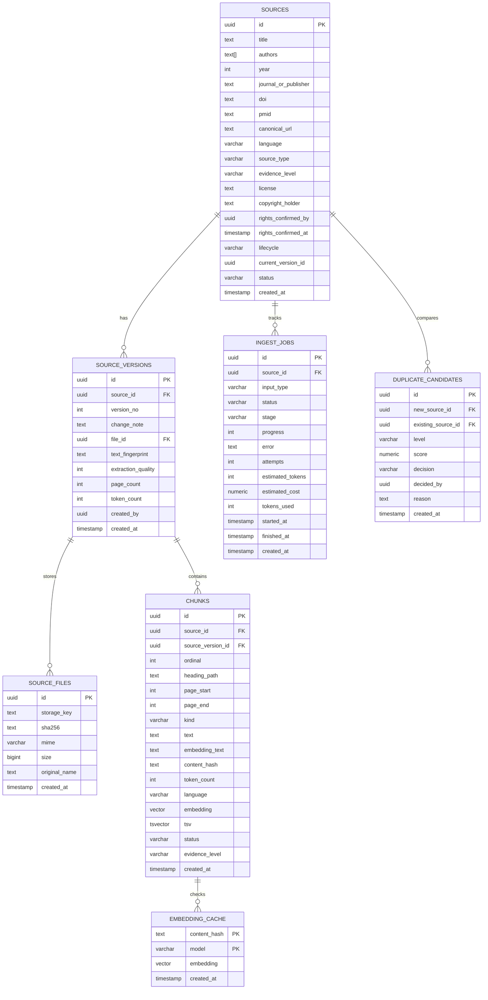
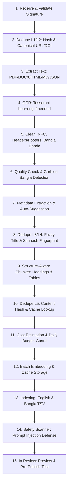

# ANALYSIS_INGESTION.md: Complete Resource Ingestion System Architecture & Migration Plan

**Author:** Principal Engineer  
**Project:** DocMate AI  
**Scope:** Safe, Scalable, Production-Grade Biomediacl Knowledge Ingestion Pipeline  
**Date:** November 2026  

---

## 1. Executive Summary

DocMate AI is a closed-library clinical decision support platform built on the hard rule that every clinical assertion must be grounded in an immutable, verified excerpt from an internal medical library with deterministic verbatim quote verification.

Currently, the platform relies on a minimal CLI script (`scripts/ingest.ts`) that reads static markdown files from `data/library`, performs rudimentary word-count chunking, and inserts them into PostgreSQL. Administrators have no web-based mechanism to ingest new clinical guidelines, research papers, textbooks, or journal articles.

This document presents the architectural analysis, gap assessment, database migration strategy, and phase-by-phase implementation plan for a complete, resilient, and secure resource ingestion pipeline.

---

## 2. Current State Audit ("What Exists")

### 2.1 Schema (`src/db/schema.ts`)
* **`sources` table**:
  - Columns: `id` (uuid), `title` (text), `type` (varchar), `year` (int), `license` (text), `url` (text), `status` (varchar 'active'|'archived'), `createdAt` (timestamp).
  - Limitations: No version tracking, no authors, no DOI/PMID, no language flag, no copyright confirmation, no lifecycle stages (`draft`, `in_review`, `approved`, `published`, `retired`, `retracted`), no link to original stored files.
* **`chunks` table**:
  - Columns: `id` (uuid), `sourceId` (references `sources.id`), `page` (int), `section` (text), `text` (text), `embedding` (vector(1536)), `tsv` (tsvector), `evidenceLevel` (varchar), `hash` (text), `createdAt` (timestamp).
  - Index: GIN index on `tsv` (`chunks_tsv_idx`).
  - Limitations: Tied directly to `source_id` without versioning (`source_version_id`), no heading hierarchy path (`heading_path`), no chunk classification (`kind`: `body`, `table`, `list`, `skip`, `references`), no embedding text representation, no token counts, no chunk status (`active` vs `retired`), no HNSW vector index.

### 2.2 Ingestion Engine (`scripts/ingest.ts`)
* Reads only local `.md` and `.txt` files in `data/library`.
* Custom parsing of basic markdown headers (`### Section`).
* Fixed sliding-window word chunking (~500 words, 10% overlap), which cuts sentences abruptly and ignores syntactic sentence boundaries (especially the Bengali danda `।`).
* Direct OpenAI API calls without a persistent embedding cache, leading to duplicate API fees if executed repeatedly.
* Minimal transaction lock (`pg_advisory_xact_lock`).

### 2.3 Retrieval & Verification Engine (`src/lib/retrieval.ts`, `src/lib/verifier.ts`)
* **Hybrid Search**: Runs vector distance (`<=>`) and Postgres full-text search (`ts_rank` on `plainto_tsquery('english', ...)`) in parallel, combining ranks via Reciprocal Rank Fusion ($k=60$).
* **Language Limitation**: Uses only the Postgres `'english'` dictionary for full-text search, which fails to stem or index Bengali text effectively.
* **Verification**: `verifyQuoteInChunk` checks normalized whitespace substring containment. This is deterministic and compliant with Hard Rule 3.
* **Evidence Sheet (`src/components/shared/EvidenceSheet.tsx`)**: Fetches chunk text by ID and renders an inline highlighted `<mark>` quote. It cannot currently show original PDF pages, document structure, or web provenance.

### 2.4 Admin UI (`src/app/[locale]/admin/library/page.tsx`)
* Simple table listing source titles, years, license, and chunk count.
* Only action is a single toggle button between `active` and `archived`.
* Zero ingestion capability, queue inspection, or document review screens.

### 2.5 Security & Permissions (`src/lib/permissions.ts`, `docs/ACCESS.md`)
* Feature keys include `library.ask`, `library.browse`, and `library.manage`.
* Missing granular ingestion permissions: `library.ingest`, `library.review`, and `library.retire`.

---

## 3. Gap Analysis ("What Is Missing")

| Capability | Current State | Target Ingestion Architecture |
| :--- | :--- | :--- |
| **Input Formats** | Only local `.md` / `.txt` | PDF (text & scanned), DOCX, TXT, MD, HTML, JSON, and ZIP archives |
| **External Connectors** | None | Web page URLs, direct PDF URLs, DOI (Crossref), PMID/PMCID (NCBI / Europe PMC) |
| **Network Security** | No outbound link fetching | Strict SSRF defense: DNS pre-lookup, private/cloud IP blocking, redirect hop validation |
| **Job Execution** | Synchronous CLI script | Postgres-backed background worker queue (idempotent, resumable, with progress tracking) |
| **File Storage** | None (only text in DB) | Pluggable `StorageDriver` (`local` / `s3`) retaining raw source files for authentic page rendering |
| **Deduplication** | None (ad-hoc hash check) | 5-Level Deduplication: (1) SHA256 file, (2) Canonical URL/DOI/PMID, (3) Fuzzy Metadata, (4) Simhash Text Fingerprint, (5) Chunk Content Hash |
| **Bangla Processing** | Ignored; English tsvector | Danda `।` sentence splitting, UTF-8 NFC normalization, garbled font detection, `'simple'` tsvector |
| **Chunking Engine** | Naive word counter | Structure-aware: heading paths, markdown table preservation, list cohesion, token-based bounds |
| **Cost & Embedding** | Repeated API calls | Persistent `embedding_cache`, budget caps, cost estimator, approval thresholds for large jobs |
| **Lifecycle & Versioning** | Binary `active` vs `archived` | `draft` $\to$ `in_review` $\to$ `approved` $\to$ `published` $\to$ `retired` / `retracted`; multi-version tracking |
| **Safety & Governance** | None | Prompt injection scanner for ingested chunks; comprehensive audit trail on all actions |
| **Retrieval Optimization**| Unindexed vector scan | HNSW index on `chunks.embedding`, Small-to-Big context expansion, query caching, p95 benchmark |

---

## 4. Schema & Data Model Evolution

### 4.1 Schema Migration Principles
1. **Never Delete Data**: Existing rows in `sources` and `chunks` must be preserved intact.
2. **Chunk ID Stability**: Existing `chunks.id` values are referenced in historical patient cases, audits, and prescriptions. They must never be regenerated or altered.
3. **Additive Migrations**: New columns are added as nullable or with backward-compatible defaults.
4. **Versioning Integration**: Every existing source will be backfilled with an initial `source_versions` record (Version 1), and existing chunks will be linked to that version.

### 4.2 Extended & New Tables



---

## 5. Migration Plan for Existing Data

### Step 1: Additive Schema Execution
Run migration script adding all new tables (`source_files`, `source_versions`, `ingest_jobs`, `embedding_cache`, `duplicate_candidates`) and new columns to `sources` and `chunks`.

### Step 2: Source & Chunk Backfill
For each existing source in `sources`:
1. Check if a `source_versions` record exists. If not, create Version 1:
   - `version_no = 1`
   - `change_note = 'Initial migration baseline'`
   - `created_at = source.created_at`
2. Update `sources`:
   - Set `current_version_id` to the newly created Version 1.
   - Set `lifecycle = 'published'`.
   - Set `language = 'en'`.
   - Set `source_type = source.type`.
   - Set `evidence_level = 'Ia'`.
3. Update `chunks` belonging to this source:
   - Set `source_version_id = version_1.id`.
   - Set `status = 'active'`.
   - Set `kind = 'body'`.
   - Set `ordinal = page * 1000 + auto_increment`.
   - Set `heading_path = section`.
   - Set `page_start = page`, `page_end = page`.
   - Set `content_hash = hash` (or compute sha256 of normalized text).
   - Compute `token_count` and `embedding_text = title + ' > ' + section + '\n\n' + text`.
   - Populate `embedding_cache` with `(content_hash, 'text-embedding-3-small', embedding)`.

### Step 3: Index Construction
1. Create GIN index on `chunks.tsv`.
2. Create BTree indexes on `chunks.content_hash`, `chunks.source_version_id`, `sources.doi`, and `sources.canonical_url`.
3. Create HNSW index on `chunks.embedding` using vector cosine distance:
   ```sql
   CREATE INDEX IF NOT EXISTS chunks_embedding_hnsw_idx 
   ON chunks USING hnsw (embedding vector_cosine_ops)
   WITH (m = 16, ef_construction = 64);
   ```

---

## 6. Pipeline Architecture (15 Resumable Stages)

The background worker executes jobs stage-by-stage. Every stage is idempotent:



### Key Stage Guarantees:
- **SSRF Guard**: For URL/DOI/PMID ingestion, blocks loopback (`127.0.0.0/8`), private subnets (`10.0.0.0/8`, `172.16.0.0/12`, `192.168.0.0/16`), link-local (`169.254.0.0/16`), cloud metadata endpoints (`169.254.169.254`), and validates DNS before and after redirects (max 3 hops).
- **Bangla Legibility Guard**: Detects legacy ANSI/ASCII font encoding corruptions (e.g., SutonnyMJ unmapped glyphs) and flags extraction quality $< 60$ with clear explanatory warnings in Bangla and English.
- **Budget & Cost Guard**: Before sending batches to the OpenAI Embeddings API, estimates token count against a configurable daily ingestion limit ($ limit/day). If an individual ingestion job exceeds the admin approval threshold (default $5.00), it pauses in `awaiting_approval`.

---

## 7. Retrieval Evolution & Benchmarking

1. **Hybrid RRF Search**:
   - Filter query strictly to published sources (`s.lifecycle = 'published' AND s.status = 'active' AND c.status = 'active'`).
   - Use `simple` dictionary for Bangla chunks and `english` for English chunks.
   - Combine dense vector distance and sparse keyword ranks with Reciprocal Rank Fusion ($k=60$).
2. **Small-to-Big Retrieval**:
   - Return the highest-scoring core chunk, but expand context by retrieving adjacent ordinal chunks from the same source version up to a token budget (~1,200 tokens).
   - Citations and verifications remain strictly anchored to the specific chunk ID containing the verbatim quote.
3. **Retrieval Benchmark (`npm run bench:retrieval`)**:
   - Generates/indexes synthetic chunks (target 100,000).
   - Executes warm and cold multi-query hybrid evaluations.
   - Asserts $p50 < 100\text{ ms}$ and $p95 < 300\text{ ms}$.

---

## 8. Phased Implementation Roadmap

* **Phase 0**: Analysis and `ANALYSIS_INGESTION.md` *(Completed)*
* **Phase 1**: Database schema migration, storage driver abstraction (`local` & `s3`), Postgres job queue, and stable chunk ID backfill migration.
* **Phase 2**: Format extractors (PDF, DOCX, HTML, TXT, JSON), text normalizer, quality scorer, structure-aware chunker, and embedding cache.
* **Phase 3**: Five-level deduplication engine, versioning lifecycle, retirement/retraction mechanics, cost & budget guards.
* **Phase 4**: External link, DOI, and PMID connectors with strict SSRF protection; JSON schema importers with field mapping.
* **Phase 5**: Admin UI: 4-tab Add Resources modal, Queue monitor, Duplicate candidate decision dialog, Review page with pre-publish retrieval test, and Source detail/versioning screens.
* **Phase 6**: Retrieval enhancements: Small-to-Big context expansion, query caching, HNSW index optimization, and `bench:retrieval` script.
* **Phase 7**: Security hardening, audit trails, comprehensive unit/integration/E2E tests, and operational documentation (`docs/INGESTION.md`, `docs/ACCESS.md`).

---
*Ready for Phase 1 execution upon review.*
