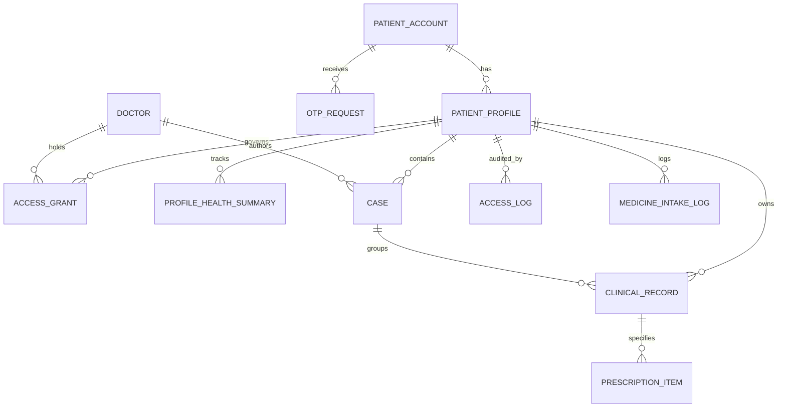

# ANALYSIS_PATIENT_UPGRADE.md — Patient-Centred Architectural Upgrade Analysis

**Document Version:** 1.0.0  
**Status:** Approved for Implementation (Phase 0 Complete)  
**Author:** Principal Engineer & Clinical Safety Architecture Reviewer  
**Target Environment:** DocMate AI (Production Clinical SaaS for Bangladesh)  

---

## 1. Executive Summary & Paradigm Shift

DocMate AI is evolving from a siloed **Doctor-Centric** record model to an integrated, longitudinal **Patient-Centred** architecture. 

In the previous version, a patient was treated as an isolated record owned by a specific physician (`patients.doctor_id = user_id`). If a patient visited multiple clinics or consultancies, each physician was forced to create disconnected patient profiles, fragmenting the patient's medical history, obscuring critical drug allergies, and preventing unified patient access to prescriptions and dosage schedules.

### The New Patient-Centred Model:
1. **Phone-Number Accounts**: Every patient account (`patient_accounts`) is keyed to a unique E.164 normalized mobile phone number (`+8801XXXXXXXXX`).
2. **Multi-Profile Support**: A single mobile account can hold multiple family members or dependent profiles (`patient_profiles` with relations: `self`, `child`, `spouse`, `parent`, `other`), catering directly to Bangladeshi healthcare realities where families share a single smartphone.
3. **Explicit Patient-Controlled Access Grants**: A physician sees:
   - **(a)** Every record that physician authored (`authored_by = doctor_id`).
   - **(b)** Other physicians' historical records for that profile **only while an active, unexpired, unrevoked access grant (`access_grants`) exists**, verified by an OTP sent to the patient's phone.
4. **Preserved Core Invariants**:
   - **Closed Internal Library Only**: AI utilizes only verified passages from approved medical textbooks and clinical protocols.
   - **Verbatim Citations**: Every clinical assertion requires a chunk ID and code-verified exact quote.
   - **Abstention by Design**: If evidence is incomplete or conflicting, the system returns `insufficient_evidence` with missing information prompts.
   - **Doctor Final Authority**: Persistent disclaimer on all clinical views (*"Clinical decision support. The final decision is yours."*).
   - **Deterministic Medicine Safety**: Drug interactions, contraindications, and dose calculations originate solely from structured tables and deterministic code—never LLM free text.
   - **Strict Role Walls**: Patients never receive an AI diagnosis or dose recommendation; students, researchers, and medicine controllers never access patient PHI.

---

## 2. Current Architecture & "One Doctor Owns Patient" Assumptions

### 2.1 Current Schema Structure (`src/db/schema.ts`)
- `patients`: Contains `doctorId` (foreign key to `users.id`) and encrypted PII (`nameEncrypted`, `phoneEncrypted`).
- `encounters`: Foreign keys `patientId` (to `patients.id`) and `doctorId` (to `users.id`).
- `cases`: Contains `doctorId` and string `patientCode`, disconnected from normalized patient accounts.
- `prescriptions`: Contains `doctorId` and `patientId`.
- `patientSchedules`, `patientReports`, `patientPreVisits`: Directly link to `patientId`. In the patient portal API routes, these queries currently resolve using `db.select().from(patients).limit(1)` as a prototype workaround.

### 2.2 Exhaustive Inventory of "Doctor Owns Patient" Assumptions Across Codebase

| File Location | Current Assumption / Invariant | Required Change for Patient-Centred Upgrade |
| :--- | :--- | :--- |
| `src/lib/permissions.ts` (`assertPatientDataScope`) | Checks `if (!caseDoctorId \|\| caseDoctorId !== user.id) return 'cross_doctor_access_prohibited'`. | Support active `access_grants`. Doctor can access records if `authoredBy === doctorId` OR if an active grant (`scope: 'full_history'`) exists for `profileId`. |
| `src/lib/case-access.ts` (`ownedCase`) | `and(eq(cases.id, id), eq(cases.doctorId, doctorId))`. | Allow access if doctor created the case OR has an active access grant covering the case's profile. |
| `src/app/api/patients/route.ts` | `where(eq(patients.doctorId, user.id))` in GET. When creating in POST, sets `doctorId: user.id`. | Replace with Phone Search returning masked profile cards. New profile creation creates account (if phone new), profile, and a `created_profile` access grant. |
| `src/app/api/patients/[id]/route.ts` | Checks `caseDoctorId: patient.doctorId` via `assertPatientDataScope`. | Evaluate `hasActiveGrant(doctorId, profileId)` or `authoredBy === doctorId`. Return combined timeline if grant active. |
| `src/app/api/cases/route.ts` | `where(eq(cases.doctorId, user.id))`. | Filter by cases authored by doctor OR cases of profiles with active access grants. |
| `src/app/api/cases/[id]/route.ts` | Asserts case ownership strictly by `caseRecord.doctorId === user.id`. | Allow case retrieval if doctor is author or has active grant. |
| `src/app/api/prescriptions/route.ts` | `where: user.role === 'patient' ? eq(prescriptions.patientId, user.id) : eq(prescriptions.doctorId, user.id)`. | Patient views prescriptions of their account profiles. Doctor views prescriptions authored by doctor plus grant-authorized prescriptions. |
| `src/app/api/prescriptions/[id]/safety-check/route.ts` | Validates `caseDoctorId: rx.doctorId`. | Feeds health summary and past prescriptions of the profile into safety engine if grant covers them; warns if grant is missing. |
| `src/app/api/patient/prescriptions/route.ts` | Resolves first patient via `.limit(1)`. | Authenticate via patient phone session; return released prescriptions for active profile. |
| `src/app/api/patient/schedules/route.ts` | Resolves first patient via `.limit(1)`. | Filter schedules for active profile; log dose mark events to `medicine_intake_log`. |
| `src/app/api/patient/reports/route.ts` | Resolves first patient via `.limit(1)`. | Query reports by `profileId`; allow setting sharing scope per report. |
| `src/app/api/patient/pre-visit/route.ts` | Resolves first patient via `.limit(1)`. | Tie pre-visit questionnaire directly to `profileId`. |
| `src/app/api/patient/consent/route.ts` | Updates `patients.consentObtained`. | Manage grant revocations and log to `access_log` and `patientConsentLogs`. |
| `src/app/[locale]/dashboard/page.tsx` | Counts `patients.doctorId = user.id`. | Count distinct profiles seen/consulted by the doctor. |
| `src/app/[locale]/patients/new/page.tsx` | 4-step intake creates isolated patient record tied to doctor. | Replaced by 2-step Find-or-Create flow: Step 1 Phone lookup, Step 2 Profile selection/creation with duplicate detection, followed by Case Creation. |
| `src/app/[locale]/portal/page.tsx` | Shows single static patient view without profile switching. | Multi-profile account header with switcher, Taken dose logging, permissions viewer, access log. |
| `tests/access-control.test.ts` | Test #6 expects `cross_doctor_access_prohibited` for any cross-doctor case query. | Update test to verify that without grant, access is denied; with an active grant, released records are accessible; upon revocation, access immediately stops. |

---

## 3. Target Relational Schema Design



### 3.1 New Core Tables
1. **`patient_accounts`**:
   - `id`: UUID (Primary Key).
   - `phone`: `varchar(30)` (E.164 format, e.g. `+8801712345678`, unique).
   - `phone_normalized`: `varchar(30)` (indexed for rapid exact match).
   - `created_at`: Timestamp with timezone.
   - `updated_at`: Timestamp with timezone.

2. **`patient_profiles`**:
   - `id`: UUID (Primary Key).
   - `account_id`: UUID (Foreign Key to `patient_accounts.id`, on delete cascade).
   - `relation`: `varchar(30)` (`self`, `child`, `spouse`, `parent`, `other`).
   - `name`: Text (or encrypted).
   - `name_encrypted`: Text (AES-256-GCM).
   - `date_of_birth`: Date (optional).
   - `age`: Integer (computed or provided).
   - `gender`: `varchar(20)` (`male`, `female`, `other`).
   - `blood_group`: `varchar(10)` (optional).
   - `address_encrypted`: Text (optional).
   - `nid_encrypted`: Text (optional).
   - `created_by`: UUID (Foreign Key to `users.id`, nullable).
   - `claimed`: Boolean (default `false`, set to `true` once patient logs in).
   - `created_at`, `updated_at`: Timestamps.

3. **`profile_health_summary`**:
   - `id`: UUID (Primary Key).
   - `profile_id`: UUID (Foreign Key to `patient_profiles.id`, on delete cascade).
   - `version`: Integer (starts at 1, incremented on every edit for optimistic locking).
   - `allergies`: JSONB (`string[]`).
   - `chronic_conditions`: JSONB (`string[]`).
   - `current_medicines`: JSONB (`{ brand: string; generic: string; dose?: string }[]`).
   - `blood_group`: `varchar(10)`.
   - `updated_by`: UUID (Foreign Key to `users.id`).
   - `updated_at`: Timestamp.
   - `change_reason`: Text (mandatory explanation of update).

4. **`access_grants`**:
   - `id`: UUID (Primary Key).
   - `profile_id`: UUID (Foreign Key to `patient_profiles.id`, on delete cascade).
   - `doctor_id`: UUID (Foreign Key to `users.id`, on delete cascade).
   - `scope`: `varchar(30)` (`this_doctor_only` | `full_history`).
   - `status`: `varchar(30)` (`requested` | `active` | `expired` | `revoked`).
   - `granted_via`: `varchar(30)` (`otp` | `created_profile` | `patient_portal`).
   - `expires_at`: Timestamp (nullable for indefinite or 7/30/90 days).
   - `created_at`: Timestamp.
   - `revoked_at`: Timestamp (nullable).

5. **`otp_requests`**:
   - `id`: UUID (Primary Key).
   - `phone`: `varchar(30)` (E.164 format).
   - `purpose`: `varchar(30)` (`login` | `grant_access`).
   - `code_hash`: `varchar(64)` (SHA-256 hash of 6-digit OTP).
   - `expires_at`: Timestamp (5 minutes validity).
   - `attempts`: Integer (default 0, max 5).
   - `used_at`: Timestamp (nullable).
   - `created_at`: Timestamp.

6. **`access_log`**:
   - `id`: UUID (Primary Key).
   - `who`: UUID (Foreign Key to `users.id`).
   - `what_profile`: UUID (Foreign Key to `patient_profiles.id`).
   - `which_records`: JSONB or Text (description of resources viewed).
   - `when`: Timestamp.
   - `why`: `varchar(50)` (`visit`, `history_view`, `search`, `prescription_created`).
   - `ip_address`: `varchar(64)`.
   - `user_agent`: Text.

7. **`medicine_intake_log`**:
   - `id`: UUID (Primary Key).
   - `prescription_item_id`: UUID (Foreign Key to `prescription_items.id`).
   - `profile_id`: UUID (Foreign Key to `patient_profiles.id`).
   - `taken_at`: Timestamp.
   - `logged_by`: UUID (patient or doctor).

8. **`idempotency_keys`**:
   - `key`: `varchar(100)` (Primary Key).
   - `route`: `varchar(200)`.
   - `result`: JSONB (persisted output to guarantee idempotency on retry).
   - `created_at`: Timestamp.

---

## 4. Phone Normalization & OTP Architecture

### 4.1 Phone Helper (`src/lib/phone.ts`)
- **Accepted Inputs**:
  - Bangladeshi local: `01712345678` (11 digits, prefixes `013`-`019`).
  - International without plus: `8801712345678` (13 digits).
  - International with plus: `+8801712345678` (14 characters).
  - Bengali Numerals: `০১৭১২৩৪৫৬৭৮`, `+৮৮০১৭১২৩৪৫৬৭৮`.
- **Normalization Output**: Standard E.164 `+8801XXXXXXXXX`.
- **Display Formatter**: `01712-345678` for Bengali UI clarity.
- **Validation**: Regex `^\+8801[3-9]\d{8}$`.

### 4.2 OTP Engine & DEMO_MODE Security Guard
- **Demo Mode Configuration**:
  - Controlled by `process.env.DEMO_MODE === 'true'`.
  - While enabled: OTP is fixed at `123456` for any phone number.
  - UI displays persistent warning banners in login and header: *"ডেমো মোড: ওটিপি ১২৩৪৫৬"*.
  - **Hard Safety Guard**: If `process.env.NODE_ENV === 'production'` and `process.env.DEMO_MODE === 'true'`, the application **strictly refuses to start**, throwing a fatal error, unless `process.env.ALLOW_DEMO_IN_PRODUCTION === 'true'` is explicitly configured (in which case a loud security alert is logged on every startup).
- **Real Production Mode**:
  - Secure random 6-digit number (`crypto.randomInt(100000, 999999)`).
  - Stored as SHA-256 hash in `otp_requests`.
  - Expired after 5 minutes.
  - Max 5 failed attempts before permanent invalidation.
  - Minimum 60-second cooldown between resends.
  - Rate-limited per phone and per IP.
  - Pluggable `SmsProvider` interface (`ConsoleSmsProvider`, `BangladeshiSmsGatewayStub`).

---

## 5. Doctor & Patient Workflows

### 5.1 Doctor: Find-or-Create Patient & Start Case
```
[ Step 1: Doctor inputs Phone Number ]
             │
             ▼
[ Search Phone in patient_accounts ]
             │
     ┌───────┴───────┐
     ▼               ▼
[ Found ]       [ Not Found ]
     │               │
     │               ├─ Show "রোগী পাওয়া যায়নি"
     │               └─ Button: "নতুন রোগীর প্রোফাইল তৈরি করুন"
     │                     │
     │                     ▼
     │               [ Enter Name, Age, Sex, Consent Checkbox ]
     │               [ Duplicate Warning Check ]
     │               [ Creates patient_account + patient_profile ]
     │               [ Auto-grants 'this_doctor_only' access ]
     ▼
[ Profile Selection Card: 'রহিম, ৩৫, পুরুষ' ]
     │
     ▼
[ Check Existing Records by other Doctors ]
     │
     ├─ [ Records from other doctors exist ] ──► Banner: "পুরনো ইতিহাস দেখতে রোগীর অনুমতি লাগবে"
     │                                            │
     │                                            ▼ [ Click "অনুমতি নিন" ]
     │                                            [ Consent Sheet: OTP sent to Patient ]
     │                                            [ Doctor inputs OTP 123456 + Selects 7/30/90 Days ]
     │                                            [ Grant status = 'active', scope = 'full_history' ]
     │                                            (Or click "এখন না" to proceed with own records only)
     ▼
[ Pre-fill Case with Health Summary (Allergies, Meds, Conditions) ]
     │
     ▼
[ Interactive Case Workspace (Analysis, Treatment, Safety Checks) ]
     │
     ▼
[ Finalize BMDC Prescription (Transferred to Patient App) ]
```

### 5.2 Patient Portal Workflow
- **Login**: Phone number + OTP (123456 in demo).
- **Header**: Account Profile Switcher (switch between Self, Child, Spouse, Parent).
- **Home**: 4 large cards:
  1. **আমার ওষুধ (My Medicines)**: Today's active doses categorized into Morning, Noon, Night, Before/After meals. Large **'খেয়েছি' (Taken)** button logs timestamp to `medicine_intake_log`.
  2. **আমার প্রেসক্রিপশন (My Prescriptions)**: List of finalized prescriptions by date and doctor, with clean view and PDF download.
  3. **রিপোর্ট (Reports)**: Diagnostic test results from doctors and patient-uploaded reports. Sharing toggle per upload.
  4. **অনুমতি (Permissions & Privacy)**:
     - Active doctor grants list with scope, expiry, and **'অনুমতি বাতিল করুন' (Revoke)** button.
     - Live **'কে আমার তথ্য দেখেছে' (Access Log)** audit trail.
     - Dependent profiles management (Add child, parent).
     - Privacy requests (Export data, Delete data to Super Admin queue).

---

## 6. Dynamic Feature Access Matrix Additions

10 new granular feature keys will be added to the platform:

| Feature Key | `super_admin` | `doctor` | `student` | `researcher` | `patient` | `medicine_controller` | Description |
| :--- | :---: | :---: | :---: | :---: | :---: | :---: | :--- |
| **`patient.search`** | - | **Y** | - | - | - | - | Phone number lookup for patient profiles (masked cards) |
| **`patient.create`** | - | **Y** | - | - | - | - | Create new patient profile under phone account |
| **`history.request`** | - | **Y** | - | - | - | - | Request OTP grant for cross-doctor past medical history |
| **`history.view`** | **BG** | **Y** | - | - | **own** | - | View longitudinal clinical history timeline and trends |
| **`portal.profiles`** | - | - | - | - | **own** | - | Manage dependent family profiles under account |
| **`portal.prescriptions`** | - | - | - | - | **own** | - | View and download finalized prescriptions |
| **`portal.reports`** | - | - | - | - | **own** | - | Upload and view diagnostic lab reports |
| **`portal.medicine_schedule`**| - | - | - | - | **own** | - | Daily dosage schedule and taken dose logging |
| **`portal.permissions`** | - | - | - | - | **own** | - | View, grant, and revoke doctor access permissions |
| **`portal.access_log`** | - | - | - | - | **own** | - | Read patient-facing audit log of who accessed records |

---

## 7. Migration Plan for Existing Data

### 7.1 Migration Safety Guarantees
- **Non-Destructive**: Never drop or delete existing tables or records.
- **Repeatable & Idempotent**: Uses `ON CONFLICT DO NOTHING` / `UPDATE` clauses.
- **Dry-Run Mode**: Script executable with `--dry-run` to output exact transformation metrics without modifying state.
- **Rollback Script**: Companion rollback script restores schema and references to previous state if needed.

### 7.2 Migration Execution Steps
1. **Create New Tables**: `patient_accounts`, `patient_profiles`, `profile_health_summary`, `access_grants`, `otp_requests`, `access_log`, `medicine_intake_log`, `idempotency_keys`.
2. **Add Profile Foreign Keys**: Add `profile_id` to `cases`, `encounters`, `prescriptions`, `patient_schedules`, `patient_reports`, `patient_pre_visits`.
3. **Migrate Existing Patients**:
   - For every patient in `patients`:
     - Decrypt phone number. If phone is valid, normalize to E.164.
     - Insert or locate matching `patient_accounts` record.
     - Create `patient_profiles` record with `account_id`, `name`, `age`, `gender`, `blood_group`, `relation: 'self'`.
     - Create initial `profile_health_summary` (v1) with existing allergies and conditions.
     - Create default `access_grants` record for `doctorId` with `scope: 'this_doctor_only'`, `granted_via: 'created_profile'`, `status: 'active'`.
     - Populate `profile_id` on all linked `cases`, `encounters`, and `prescriptions`.
   - For patients with missing or dummy phones:
     - Place into an unlinked queue (`needs_phone = true`) visible strictly to the creating doctor until updated.
4. **Seed Rich Demo Scenario**:
   - Accounts for 5 demo phones: `01700000001` to `01700000005`.
   - Multi-profile account (`01700000002`): Parent ("রফিকুল ইসলাম", 52) and Dependent Child ("সাদমান ইসলাম", 8).
   - Cross-Doctor Consent Demo (`01700000001`): Patient "কামাল হোসেন" with prior records authored by Doctor A (`doctor@docmate.ai`), requiring Doctor B (`doctor2@docmate.ai`) to request OTP consent.

---

## 8. Risks, Edge Cases & Mitigation Strategies

| Risk / Edge Case | Likelihood | Impact | Architectural Mitigation |
| :--- | :---: | :---: | :--- |
| **Shared Family Phones** | High | High | Explicit relation tags (`self`, `child`, `spouse`, `parent`). Profile switcher is prominent. First login presents educational modal explaining shared phone access. |
| **Duplicate Patient Creation** | High | Medium | Fuzzy duplicate detection during profile creation: warns if same name and age ($\pm 2$ years) already exists on that phone. |
| **Stale Grant Caching** | Medium | Critical | Server-side permission cache invalidation on grant revocation. Database query checks `expires_at > NOW()` and `status = 'active'` on every request. |
| **Doctor Phone Enumeration** | Medium | High | Rate-limiting phone searches to 30/hour per physician. Every search logs to `access_log`. Result returns only masked cards (first name + initials, age, sex, masked phone). |
| **Accidental Demo Mode in Production** | Low | Critical | Refuse startup if `NODE_ENV === 'production'` and `DEMO_MODE === 'true'`, unless `ALLOW_DEMO_IN_PRODUCTION === 'true'`. |
| **Concurrent Health Summary Edits** | Medium | Medium | Optimistic locking using integer `version`. If conflicting version detected, present doctor with both versions to choose/merge. |

---

## 9. Phased Implementation Roadmap

- **Phase 0**: Deep Analysis & `ANALYSIS_PATIENT_UPGRADE.md` *(Complete)*.
- **Phase 1**: Database Schema, Phone Normalization Helper, Migration Script with `--dry-run` and rollback, Patient Phone + OTP Login with Production Guard.
- **Phase 2**: Doctor Find-or-Create Flow, Duplicate Warning, Profile Selection, Case Creation under Profile, Idempotency.
- **Phase 3**: Access Grants System, Consent Sheet with OTP, Longitudinal History Timeline, Trends, Access Log, Grant-Covered Safety Checks.
- **Phase 4**: Patient Self-Service Portal (Multi-Profile Switcher, Today's Medicines with Taken Dose Logging, Prescriptions, Reports, Permissions Management, Privacy Requests).
- **Phase 5**: Stability & Edge Cases (Optimistic Locking, Anti-Enumeration Rate Limits, Super Admin Patient Governance Tools, New Feature Keys & Tests).
- **Phase 6**: UX Polish for Senior Clinicians, Bilingual Verification, Playwright E2E Suite, Documentation Updates (`ACCESS.md`, `PATIENT_FLOW.md`, `README.md`, `COMPLIANCE.md`).
