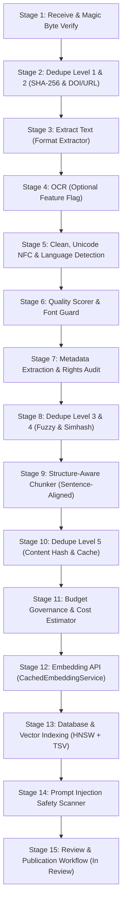

# DocMate AI - Safe Biomedical Resource Ingestion System

**DocMate AI Internal Clinical Decision Support System**  
**Engineering Specification & Operating Runbook**

---

## 1. Overview & Architecture Principles

DocMate AI operates strictly on a **Closed Medical Library**. In accordance with the core system rules:
- **No Hallucinations / Zero Outside Knowledge**: The AI assistant answers strictly and exclusively using retrieved excerpts from verified internal resources.
- **Verbatim Citation Requirement**: Every diagnostic assertion and recommendation must cite an immutable `chunk_id` and include a verbatim quote verified by deterministic code.
- **Data, Never Instructions**: Library text is parsed strictly as untrusted clinical data, never as executable model instructions.
- **Immutable Chunks**: Chunks are never modified in place. Updating a source creates a new version (`source_versions`). Retired chunks remain in the database and citable by historical reports, but are excluded from active search.
- **Only Published Content Searchable**: A chunk is retrievable only when `sources.lifecycle = 'published' AND sources.status = 'active' AND chunks.status = 'active'`.

---

## 2. Ingestible Content & Inputs

The ingestion system accepts biomedical materials across diverse formats and web identifiers:

### 2.1 File Formats
1. **PDF**: Page-by-page text extraction (`pdf-parse`) preserving physical page numbers and page-level heading tracking. Optional OCR for scanned or garbled text.
2. **DOCX**: Rich structure extraction (`mammoth`) preserving headings, ordered/unordered lists, and clinical tables.
3. **HTML / Web Pages**: Clean article extraction via Mozilla Readability and JSDOM, dropping navigation bars, ads, and sidebars.
4. **Markdown & Plain Text (MD / TXT)**: Markdown structure parser respecting heading hierarchies (`#`, `##`, `###`).
5. **Literature JSON**: Standard structured documents (Shape A: Articles, Shape B: Books/Sections).
6. **ZIP Archives**: Unpacks and batches multiple documents in a single upload.

### 2.2 Links, DOIs & Identifiers
1. **DOI**: Resolves through Crossref REST API to fetch canonical metadata, abstract, and license. Resolves legal open-access full text where permitted.
2. **PubMed ID (PMID) / PMCID**: Resolves through NCBI E-utilities / Europe PMC REST to retrieve MEDLINE abstracts or open-access XML/text.
3. **Journal Webpage URLs**: Fetched safely through an SSRF-hardened connector with domain and IP verification.

### 2.3 The Medicine Data Rejection Guard
**Crucial Boundary**: Medicine formulary data (brands, doses, packaging, interactions, manufacturers) is **NOT** a library source.
- JSON or CSV containing medicine fields (`brand_name`, `generic_name`, `dosage_form`, `strength`, `contraindication`) is immediately rejected with HTTP 400 and a pointer to the **DGDA Medicine Controller** (`/controller`).

---

## 3. The 15-Stage Ingestion Pipeline

The ingestion process is decoupled into an asynchronous, idempotent, and resumable pipeline backed by PostgreSQL (`ingest_jobs`):



### Detailed Pipeline Stages:
1. **Receive**: Validates file magic numbers (`%PDF`, `PK\x03\x04`, etc.) rather than trusting user file extensions. Enforces a 100 MB limit, cleans file names against path traversal, runs antivirus interface check, and computes SHA-256.
2. **Dedupe Level 1 & 2**: Immediate exact hash check (same file content) or canonical identifier check (normalized DOI, PMID, canonical URL without tracking parameters).
3. **Extract**: Invokes specific extractor (`PdfExtractor`, `DocxExtractor`, `HtmlExtractor`, `TextExtractor`, `JsonExtractor`).
4. **OCR**: If enabled via settings (`ingest.ocr_enabled`), runs optical character recognition on scanned PDFs using `ben+eng` models.
5. **Clean**: Normalizes Unicode NFC, removes repeated headers/footers appearing across multiple pages, repairs broken hyphenation across line breaks, categorizes pages (`body`, `table`, `references`, `skip`), and detects language per page (`bn`, `en`, `mixed`).
6. **Quality Check**: Scores document extraction from 0 to 100 based on characters per page, empty page ratios, and garbled characters. Detects legacy ANSI Bijoy/SutonnyMJ font encodings and raises a plain-language warning.
7. **Metadata Confirmation**: Reads or normalizes title, authors, year, journal, license, and evidence level. Requires user legal rights confirmation.
8. **Dedupe Level 3 & 4**: Fuzzy metadata matching (title + author + year) and 64-bit Simhash text fingerprinting. Flags near-duplicates in `duplicate_candidates`.
9. **Structure-Aware Chunking**: Splits by headings first, then paragraphs, then sentence boundaries (respecting `.`, `?`, `!`, and Bengali danda `।`). Targets ~500 tokens with ~12% sentence-aligned overlap. Keeps tables intact as Markdown chunks.
10. **Dedupe Level 5**: Computes SHA-256 `content_hash` per chunk. Drops repeated boilerplate within the same document. Looks up `embedding_cache` to reuse existing vector embeddings at zero API cost.
11. **Cost Estimate & Budget**: Computes token count and estimated cost. If single-job cost exceeds threshold (default $2.00) or daily spending limit (default $10.00), job pauses in `awaiting_approval`.
12. **Embed**: Batches embedding requests to OpenAI API (or local embedding model), storing results in `embedding_cache`.
13. **Index**: Writes chunks to PostgreSQL with language-appropriate TSV vectors (`'simple'` for Bengali, `'english'` for English) and HNSW vector index on `chunks.embedding`.
14. **Safety Scan**: Scans text for prompt injection keywords (`ignore previous instructions`, `you are now an ai`, etc.) and flags them for reviewer attention.
15. **Finish**: Moves source to `in_review` lifecycle. Content remains private and non-searchable until a designated reviewer approves and publishes.

---

## 4. Five Levels of Deduplication

| Level | Scope | Mechanism | Action |
|---|---|---|---|
| **Level 1** | Binary File | SHA-256 checksum of raw buffer | Stops job; links directly to existing source. |
| **Level 2** | Identifiers | Normalized DOI, PMID, or Canonical URL | Stops job; alerts reviewer of duplicate material. |
| **Level 3** | Metadata | Normalized Title + First Author + Year string distance | Flags in `duplicate_candidates` table with score. |
| **Level 4** | Text Fingerprint | 64-bit Simhash with Hamming distance | Flags in `duplicate_candidates` if similarity $\ge 0.85$. |
| **Level 5** | Chunk Level | Normalized whitespace SHA-256 content hash | Drops duplicate chunks; reuses vector from `embedding_cache`. |

---

## 5. Security & SSRF Protection

All outbound network requests to external URLs, DOIs, or PMIDs are protected by `src/lib/ingestion/ssrf-guard.ts`:
- **Protocol Restrictions**: Only `http:` and `https:` permitted.
- **DNS Resolution Pre-flight**: Resolves DNS before fetching and validates resolved IP against RFC1918 private ranges (`10.0.0.0/8`, `172.16.0.0/12`, `192.168.0.0/16`), loopback (`127.0.0.0/8`), link-local / cloud metadata (`169.254.169.254`), and IPv6 equivalents.
- **Redirect Hop Inspection**: Re-resolves and inspects DNS on every redirect hop (maximum 3 hops).
- **Stream Size Limit**: Enforces a strict 100 MB maximum download cap to prevent zip-bombs or memory exhaustion.

---

## 6. Versioning & Source Retirement

### 6.1 Immutability of Existing Chunks
Existing chunk IDs (`chunks.id`) are **never modified or deleted**. Foreign keys in `student_notes.chunk_id` and `student_quizzes.citation_chunk_id` rely on immutable chunk references.

### 6.2 New Version Rollout
1. Uploading a new version of a source creates a new record in `source_versions` linked to the same `source_id`.
2. Chunks are ingested with `source_version_id`.
3. Chunks with identical `content_hash` inherit previously cached vector embeddings.
4. When the reviewer clicks **Approve & Publish**:
   - `sources.current_version_id` updates to the new version ID.
   - The new version's chunks are set to `status = 'active'`.
   - The previous version's chunks are atomically set to `status = 'retired'` within the same database transaction.
   - The in-memory retrieval cache is evicted.

### 6.3 Source Retirement & Retraction
- **Retire**: For superseded guidelines or outdated textbooks. Source lifecycle becomes `'retired'`. Chunks are set to `status = 'retired'` and immediately excluded from future clinical searches. Existing patient cases cite the chunk with a clear "Retired Source" indicator.
- **Retract**: For publisher retractions, ethical breaches, or copyright takedowns. Source lifecycle becomes `'retracted'`. Chunks are removed from retrieval; existing citations show a prominent "Retracted Source" notice.

---

## 7. Operational Runbook

### 7.1 Running the Ingestion Background Worker
The worker polls the Postgres queue (`ingest_jobs`) using `FOR UPDATE SKIP LOCKED`.

```bash
# Standalone CLI runner
npm run worker

# Or in Docker
docker compose up -d worker
```

### 7.2 Running the Retrieval Latency Benchmark
Tests 20 English and Bengali queries across the hybrid search engine and verifies that $p95 < 300\text{ ms}$:

```bash
npm run bench:retrieval
```

### 7.3 Resolving Stuck Jobs or High-Cost Alerts
1. Open Admin Panel $\rightarrow$ **মেডিকেল লাইব্রেরি (Library)** $\rightarrow$ **ইনজেশন কিউ (Ingestion Queue)**.
2. If a job has status `Awaiting Budget`, inspect the estimated token count and cost. If approved, click **Approve Budget**; the worker resumes processing immediately.
3. If a job failed due to transient network failure (e.g. Crossref rate limit), click **Retry Job** (`পুনরায় চেষ্টা করুন`).
4. To terminate a long-running or erroneous job, click **Cancel Job** (`বাতিল করুন`).

### 7.4 Handling Duplicate Warnings
In the **Review Source** page (`/admin/library/sources/[id]/review`):
- Click **Skip Duplicate** to discard the redundant submission.
- Click **Add as New Version** to adopt the submission as Version $N+1$ of the existing source.
- Click **Keep Both** if they represent distinct clinical guidelines with similar titles.
