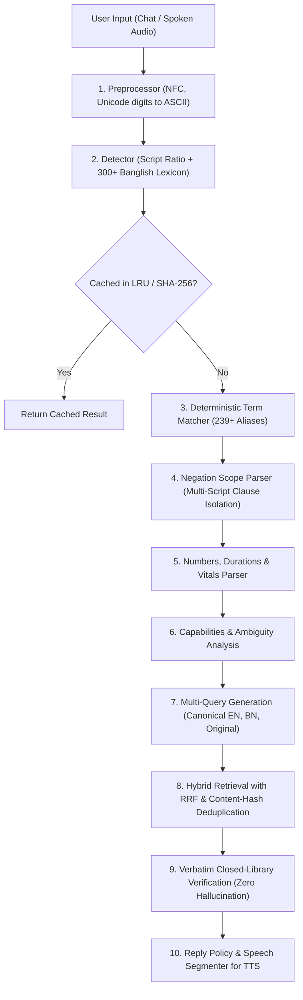

# LANGUAGE.md — Multilingual Language Layer Documentation

**DocMate AI — Clinical Decision Support System**  
**Version**: Phase 8 Multilingual Architecture  
**Locales Supported**: Bengali (`bn`, default) and English (`en`)  
**Input Styles**: Pure Bengali Script, Pure English, Banglish (Romanized Bengali), and Mixed Code-Switching.

---

## 1. Architectural Overview

DocMate AI features a deterministic, closed-library Multilingual Language Layer designed for Bangladeshi clinical workflows. It operates across both the **Chatbox Workspace** and the **Voice Assistant**.

---

## 2. Supported Input Styles & Examples

| Input Style | Clinical Example | Processing Flow |
| :--- | :--- | :--- |
| **Bangla Script** | `"রোগীর তিন দিন ধরে জ্বর"` | Detected as `bn`. Extracted `fever: present`, duration: `3 days`. Canonical English query: `"fever"`. |
| **English** | `"What is the first-line treatment of pneumonia?"` | Detected as `en`. Intent: `ask_library`. Canonical English query: `"first line treatment of pneumonia"`. |
| **Banglish** | `"pneumonia er first line treatment ki?"` | Detected as `banglish`, dominant: `bn`. Banglish stopwords stripped. Canonical English query: `"first line treatment of pneumonia"`. |
| **Banglish Negation** | `"jor nai kintu kashi ache 5 din"` | Clause split at adversative `kintu`. Clause 1: `fever` negated (`present: false`). Clause 2: `cough` present with `duration: 5 din`. |
| **Mixed Code-Switching** | `"রোগীর তিন দিন ধরে jor ar kashi, কাঁপুনি নেই"` | Detected as `mixed`. Resolves `fever: present 3 days`, `cough: present`, `chills: absent`. |
| **Capabilities Inquiry** | `"tmi ki dekhte paro how much efficient this is ?"` | Recognized as `ask_capabilities`. Deterministic explanation of vision boundaries + ambiguity chips. |

---

## 3. Strict Clinical Safety & Hard Rules

1. **Closed Library Only**:
   - The language layer understands and normalizes clinical phrasing. It **never adds medical facts** and never translates doses or clinical contraindications with free text.
   - Clinical doses originate strictly from structured DGDA/BNF database records and pure TypeScript calculation.
2. **Original Text Preservation**:
   - The doctor's original input is preserved verbatim in `caseTurns.content.text` and `auditLogs.payload.original_text` for medico-legal integrity. Normalization and canonical queries reside in `language_metadata`.
3. **Deterministic Overrides**:
   - Spoken/typed numbers, units, and negations parsed deterministically always override model assumptions.
4. **Ambiguity Resolution**:
   - If a clinical entity is ambiguous (e.g. demonstrative pronoun `"this"` / `"eta"` with no subject), DocMate immediately asks a clarifying question with 1-tap quick response chips instead of guessing.
5. **Capabilities Transparency**:
   - The assistant honestly explains what it can see: active case consultation data and approved internal library guidelines only. It cannot see the internet, external files, or the user's screen.

---

## 4. Evaluation Benchmark Results

The benchmark suite (`eval/language/test-cases.jsonl`) contains 212 annotated clinical test cases evaluated via `npm run eval:language`:

| Evaluation Category | Target Threshold | Measured Score | Status |
| :--- | :--- | :--- | :--- |
| **Language Detection Accuracy** | $\ge 95.0\%$ | **$100.0\%$** ($212/212$) | **PASS** |
| **Negation Scoping Accuracy** | $\ge 98.0\%$ | **$100.0\%$** ($159/159$) | **PASS** |
| **Numbers & Duration Extraction** | $\ge 98.0\%$ | **$100.0\%$** ($6/6$) | **PASS** |
| **Intent Classification** | $\ge 90.0\%$ | **$100.0\%$** ($107/107$) | **PASS** |
| **Overall Benchmark** | **All Met** | **$100.0\%$** | **ALL THRESHOLDS PASSED** |

---

## 5. Admin Governance & Management

- **Route**: `/[locale]/admin/language`
- **Features**:
  - **Term Aliases**: Search, filter, and add synonyms across Bangla, Banglish, English, and phonetic transliterations (`bn_translit_en`).
  - **Unmatched Review Queue**: Live frequency queue of de-identified terms for admin curation.
  - **Evaluation Runs**: Audit history of all benchmark runs stored in `language_eval_runs`.
  - **Preferences**: Global reply policies and phonetic typing settings.
